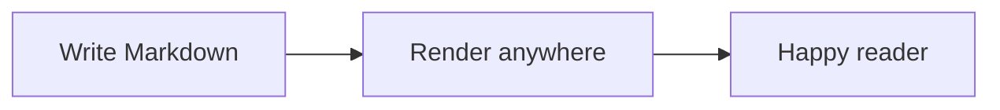

# Markdown is King, especially for AI agents

In my opinion, Markdown is the best and most widely supported format for writing.
It takes ten minutes to learn, it works almost everywhere, and it stays perfectly readable without any special tool.
And now that AI agents read and write a lot of our text, it has become even more valuable.
Notes, docs, this blog, presentations: I write all of it in Markdown these days.

<!-- more -->

I already touched on this in [[qmd|my post about QMD]]: content separated from layout, great with git, and very friendly to AI agents.
This post goes a bit wider.

## Easy to learn, readable anywhere

Markdown is just plain text with a few conventions.
Open a `.md` file in Notepad, `cat` it in a terminal, or read it on your phone: it still makes sense.
No app needed to decode it, no proprietary format, no lock-in.

## Made for git

Because Markdown is plain text, it fits perfectly in git.
I write one sentence per line, so a diff shows exactly which sentence changed.
That gives you everything developers already enjoy for code:

- A full history of every change, with the why in the commit message.
- Branches and pull requests to review writing, just like code.
- Multiple people working on the same document without overwriting each other.
- Docs living right next to the code they describe.

This very post went through a branch and a PR before it landed here.

## The conventions are everywhere

The best part: Markdown conventions have leaked into tons of apps that are not Markdown editors at all.
Teams, Slack, WhatsApp, Discord, Confluence, GitHub, Notion: they all pick up (some of) these shortcuts while you type.

````markdown
# Heading, ## Subheading
- dash for a bullet list
1. number for a numbered list
**bold**, _italic_, ~~strikethrough~~
`inline code`
```
code block
```
> quote
[link text](https://example.com)
````

Not every app supports every convention, and some use their own flavor.
WhatsApp and Slack use `*bold*` with single asterisks, and Teams uses single tildes for `~strikethrough~` (Microsoft even [admits](https://support.microsoft.com/en-us/teams/chat/use-markdown-formatting-in-microsoft-teams) it "doesn't fully match standard Markdown").
Still, the core works almost everywhere.

What I noticed is that using these conventions outside a Markdown editor makes my writing more precise and efficient.
A Teams message to a colleague with a short list and a `code snippet` is way easier to read than a wall of text.
And I never have to touch a formatting menu.

## Tools I use with Markdown

- Notes and writing: [[obsidian]].
- Documentation and this blog: [MkDocs Material](https://squidfunnel.github.io/mkdocs-material/), see [[blog-infrastructure|how this blog is built]].
- Presentations: [Marp](https://marp.app/) and [Slidev](https://sli.dev/).
- Searching my notes: [[qmd]].

And a few more worth knowing:

- [Typora](https://typora.io/): a clean editor that renders Markdown in place while you type.
- [Pandoc](https://pandoc.org/): the Swiss army knife that converts Markdown to Word, PDF, HTML, slides, and basically anything else.
- [Quarto](https://quarto.org/): Markdown plus executable code, for reports, papers, websites, and slides.
- [Docusaurus](https://docusaurus.io/) and [VitePress](https://vitepress.dev/): MkDocs alternatives for documentation sites.
- [Jupyter](https://jupyter.org/): Markdown cells next to your code, which I wrote about in [[ai-agents-data-analysis|automating data analysis with AI agents]].
- GitHub and GitLab: every `README.md`, issue, and PR description is Markdown.

## Taking Markdown further

The basics already get you far, but most tools support a few extras.

### Images

```markdown

```

### Mermaid diagrams

Write a diagram as text, and GitHub, GitLab, Obsidian, and MkDocs render it for you:

````markdown

````

Which renders as:


### Callouts

Notes, tips, and warnings that stand out from the text.
The syntax differs per tool, unfortunately:

```markdown
<!-- Obsidian -->
> [!tip] Title
> Content

<!-- GitHub -->
> [!TIP]
> Content

<!-- MkDocs Material (admonition extension) -->
!!! tip "Title"
    Content
```

On this blog, that last one renders as:

!!! tip "Callouts work here too"
    Use them for the stuff readers should not skip.

### Code blocks with syntax highlighting

Tip: always add the language after the opening backticks, so the code gets proper highlighting.

````markdown
```python
def hello():
    print("Hello, Markdown!")
```
````

## Markdown and AI agents

This is where Markdown really shines.
Making your writing, docs, and presentations available to AI agents as Markdown has great benefits:

- **Content is separated from visualization.** The agent only sees lean content, so it can focus on what matters.
- **It is very token-efficient.** No XML soup, no styling metadata, just text with a bit of structure.
- **Layout is handled separately and reused.** CSS and HTML are endlessly extendable, so one theme serves all your content.
- **Agents read and write it natively.** LLMs are great at Markdown, so they can edit your docs just like they edit code.

That is also why my [[agent-config|agent configuration]] is plain Markdown files.

## What about Word and PowerPoint?

Compare that to `.docx` and `.pptx` files:

- **Bulky.** They are zipped XML archives full of styling and metadata.
- **Hard to edit.** You need specific tools, and good luck getting an agent to make a clean change.
- **Bad with git.** Diffs are unreadable binary blobs, so collaboration means emailing `final_v3_really_final.docx` around.

Sure, sometimes you need them.
But with Pandoc or Marp you can generate them from Markdown when you do, and keep the source in plain text.

## Own your data and your tools

There is a bigger point behind all this: who actually owns your writing?
A `.pptx`, a `.docx`, a OneNote notebook, or a Notion page is usually locked into an ecosystem of tools you don't fully control.
You can only do with it what that ecosystem allows.
I learned that the hard way getting my notes out of OneNote, which I wrote about in [[obsidian|my Obsidian post]].

[[steph-ango|Steph Ango]], CEO of Obsidian, puts it well in his article [File over App](https://stephango.com/file-over-app):

> File over app is an appeal to tool makers: accept that all software is ephemeral, and give people ownership over their data.

And:

> Apps are ephemeral, but your files have a chance to last.

Markdown breaks the lock-in.
Your files sit on your own disk, and you can open them in any editor, run your own scripts on them, version them in git, search them with [[qmd]], or hand them to an AI agent.
Whatever tool comes next, your writing comes along.

Markdown is king, especially for AI agents.
