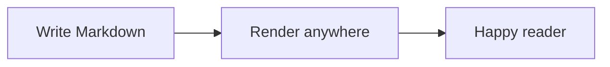

# Markdown is King

In my opinion, Markdown is the best and most widely supported format for writing.
You learn it in ten minutes, it works almost everywhere, and you can read it without any special tool.
Now that AI agents read and write so much of our text, I like it even more.
Notes, docs, this blog, presentations: I write all of it in Markdown these days.

<!-- more -->

I already touched on this in [[qmd|my post about QMD]], where I mostly talked about separating content from layout, git, and AI agents.
This post goes a bit wider.

## Easy to learn, readable anywhere

Markdown is plain text with a handful of conventions.
Open a `.md` file in Notepad, `cat` it in a terminal, or read it on your phone, and it still makes sense.
You don't need an app to decode it, and no vendor owns the format.

## Made for git

Plain text fits perfectly in git.
I write one sentence per line, so a diff shows exactly which sentence changed.
That gets you everything developers already enjoy for code:

- A full history of every change, with the why in the commit message.
- Branches and pull requests to review writing.
- Several people editing the same document without overwriting each other.
- Docs living right next to the code they describe.

This post went through a branch and a PR too, before it landed here.

## The conventions are everywhere

My favorite part is that Markdown conventions have leaked into tons of apps that aren't Markdown editors at all.
Teams, Slack, WhatsApp, Discord, Confluence, GitHub, and Notion all pick up (some of) these shortcuts while you type:

````markdown
# Heading, ## Subheading
- dash for a bullet list
1. number for a numbered list
**bold**, _italic_, ~~strikethrough~~
`inline code`
```
code block
```
> quote
[link text](https://example.com)
````

Not every app supports every convention, and some have their own flavor.
WhatsApp and Slack use `*bold*` with single asterisks, and Teams uses single tildes for `~strikethrough~`.
Microsoft even [admits](https://support.microsoft.com/en-us/teams/chat/use-markdown-formatting-in-microsoft-teams) its version "doesn't fully match standard Markdown".
The core works almost everywhere, though.

Using these conventions outside a Markdown editor has made my writing more precise and efficient.
A Teams message to a colleague with a short list and a `code snippet` is way easier to read than a wall of text, and I never touch a formatting menu.

## Tools I use with Markdown

- Notes and writing: [[obsidian]].
- Documentation and this blog: [MkDocs Material](https://squidfunnel.github.io/mkdocs-material/), see [[blog-infrastructure|how this blog is built]].
- Presentations: [Marp](https://marp.app/) and [Slidev](https://sli.dev/).
- Searching my notes: [[qmd]].

A few more worth knowing:

- [Typora](https://typora.io/), an editor that renders Markdown in place while you type.
- [Pandoc](https://pandoc.org/), which converts Markdown to Word, PDF, HTML, slides, and basically anything else.
- [Quarto](https://quarto.org/), Markdown plus executable code for reports, papers, websites, and slides.
- [Docusaurus](https://docusaurus.io/) and [VitePress](https://vitepress.dev/), alternatives to MkDocs for documentation sites.
- [Jupyter](https://jupyter.org/), with Markdown cells next to your code, which I wrote about in [[ai-agents-data-analysis|automating data analysis with AI agents]].
- GitHub and GitLab, where every `README.md`, issue, and PR description is Markdown.

## Taking Markdown further

The basics get you far, and most tools support a few extras on top.

### Images

```markdown

```

### Mermaid diagrams

Write a diagram as text, and GitHub, GitLab, Obsidian, and MkDocs draw it for you:

````markdown

````

Which renders as:


### Callouts

Callouts are boxes that make a note or warning stand out from the text.
Sadly, every tool has its own syntax:

```markdown
<!-- Obsidian -->
> [!tip] Title
> Content

<!-- GitHub -->
> [!TIP]
> Content

<!-- MkDocs Material (admonition extension) -->
!!! tip "Title"
    Content
```

On this blog, that last one renders as:

!!! tip "Callouts work here too"
    Use them for the stuff readers should not skip.

### Code blocks with syntax highlighting

Always put the language right after the opening backticks, so the code gets highlighted:

````markdown
```python
def hello():
    print("Hello, Markdown!")
```
````

## Especially for AI agents

If you want AI agents to work with your writing, docs, or presentations, give them Markdown.

It is SO much more token efficient.
There's no XML soup, no styling metadata, and no binary blob to unpack, so almost every token is actual content.
Layout lives somewhere else (CSS and HTML, endlessly extendable), and one theme can serve all your content.
The agent only sees the lean text and can focus on it.
LLMs have also seen mountains of Markdown, so they edit your docs as easily as they edit code.

I strongly believe agents are more accurate with Markdown too.
Less noise in the context window leaves more attention for what matters.
And they know the format by heart, so headings, lists, and code blocks give them structure they already understand.

### What does the research say?

I went looking for numbers and found a few.

- Tokens: when Cloudflare launched [Markdown for Agents](https://blog.cloudflare.com/markdown-for-agents/), one of their blog posts went from 16,180 tokens as HTML to 3,150 as Markdown, 80% fewer.
  [TQA-Bench](https://arxiv.org/abs/2411.19504) found the same for tables, where HTML needs roughly twice the tokens of Markdown for the same data.
- Speed and cost: fewer input tokens means cheaper, faster responses and more room in the context window.
- Accuracy: [Does Prompt Formatting Have Any Impact on LLM Performance?](https://arxiv.org/abs/2411.10541) compared plain text, Markdown, JSON, and YAML prompts on GPT models.
  GPT-3.5's score on a code translation task moved by up to 40% just by changing the format.
  GPT-4 was more stable and did best with Markdown on several benchmarks, while GPT-3.5 preferred JSON.
  No format wins for every model and task, so I read this as a strong hint, not proof.
- Lost in conversion: [a study that converted PowerPoint and PDF files to Markdown](https://arxiv.org/abs/2508.15817) for LLM question answering found that text survives fine, but meaning carried by layout and images gets lost.
  So it pays to write in Markdown from the start instead of converting later.
- Industry adoption: Cloudflare now serves Markdown to agents that ask for it, and the [llms.txt proposal](https://llmstxt.org/) asks websites to offer a Markdown version of their content for LLMs.
  OpenAI, Anthropic, and Google already publish one for their docs.

It's also why my [[agent-config|agent configuration]] is a folder of plain Markdown files.

## What about Word and PowerPoint?

A `.docx` or `.pptx` file is a zipped archive of XML, full of styling and metadata.
You need specific tools to edit one, and good luck getting an agent to make a clean change.
Git can't show a readable diff of them either, so collaborating usually means emailing `final_v3_really_final.docx` around.

Sometimes you do need them.
Pandoc or Marp can generate them from Markdown when you do, and the source stays plain text.

## Own your data and your tools

Then there's the question of who owns your writing.
A `.pptx`, a `.docx`, a OneNote notebook, or a Notion page is usually locked into tools you don't fully control, and you can only do with it what those tools allow.
I learned that the hard way getting my notes out of OneNote, which I wrote about in [[obsidian|my Obsidian post]].

[[steph-ango|Steph Ango]], CEO of Obsidian, puts it well in his article [File over App](https://stephango.com/file-over-app):

> File over app is an appeal to tool makers: accept that all software is ephemeral, and give people ownership over their data.

And:

> Apps are ephemeral, but your files have a chance to last.

Markdown files sit on your own disk.
Open them in any editor, run your own scripts on them, version them in git, search them with [[qmd]], or hand them to an AI agent.
When the next tool comes along, your writing comes with you.
